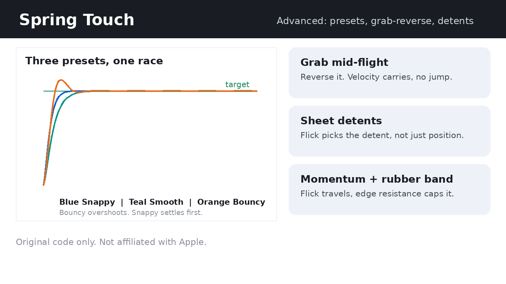

# Spring Touch

[](SKILL.md)
[](LICENSE)

**iOS-style touch animation, as an original, reusable skill.**

Cheap motion eases from A to B on a fixed curve over a fixed time.
iOS-style motion has mass: it accelerates, overshoots a little, and
settles. A user can grab it mid-flight, reverse it, and flick it, and
it never jumps.

Spring Touch turns that feel into code you can use on the web, in
SwiftUI, and in any app with animated touch. No CSS transition or
fixed easing curve is substituted for the spring.

## See it in action



<video src="docs/demo.mp4" controls width="100%"></video>

12 seconds, no sound: a spring racing a fixed easing curve, a ball
being dragged then flicked to a stop, and a card pulled past an edge
with resistance that caps before it springs back. Both files are
original, drawn from the spring code in `SKILL.md`.

## What you get

| Piece | What it does |
|---|---|
| Spring physics | Motion driven by stiffness, damping, and mass, not by a timer |
| Interruptibility | Every new animation starts from the live on-screen value, with live velocity carried forward |
| Velocity handoff | A drag release hands its velocity to the spring, so a flick travels further than a slow drag |
| Rubber-band overscroll | Progressive resistance past an edge, with a ceiling, so content stretches but cannot be dragged away |
| Tuning presets | Ready starting values for snappy, smooth, and bouncy motion |
| Reduce Motion | A fallback for users who ask for less motion |
| Verification checklist | Seven checks, including grab-and-reverse, flick, and overscroll, before calling it done |

## Quick start

1. Read `SKILL.md`. It is the whole skill, in one file.
2. Load it first when you build anything with animated touch:
   dragging, flicking, sheets, lists, cards, toggles, or overscroll.
3. Use the spring integrator from the skill, not a CSS transition,
   for anything the user can grab mid-flight.

## Code at a glance

SwiftUI, using only the public spring API:

```swift
withAnimation(.spring(response: 0.4, dampingFraction: 0.8)) {
    isExpanded.toggle()
}
```

Web, the original integrator from `SKILL.md`:

```js
// Run every frame, with dt in seconds, clamped.
velocity += (-stiffness * (x - target) - damping * velocity) * dt;
x += velocity * dt;
```

## Tuning

Start here, then tune by feel on a real phone. Faster is usually
better than slower.

| Use | SwiftUI | Web, mass 1 |
|---|---|---|
| Snappy, toggles and micro-interactions | response 0.2, damping 0.7 | stiffness 300, damping 30 |
| Smooth, default transitions | response 0.5, damping 0.9 | stiffness 170, damping 26 |
| Bouncy, playful moments | response 0.3, damping 0.6 | stiffness 200, damping 15 |

A damping fraction of 1.0 means no overshoot. Below 0.6 means
visibly bouncy. Never set a fixed duration that fights the spring:
a spring computes its own settle time.

## Repository structure

```
spring-touch/
  README.md   This page
  SKILL.md    The full skill, load this first
  LICENSE     MIT license
  docs/
    demo.png  Still image from the demo
    demo.mp4  12-second demo video
```

## Contributing

Keep this repo small and original. A change should:

- Use only original wording and original code
- Keep the spring, interruptibility, and rubber-band rules intact
- Add a check to the verification list if it adds a new behaviour
- Not copy Apple code, decompiled code, branding, assets, or an
  exact iOS user interface

## Legal, in short

Spring Touch is independent and original. It is not an Apple
product, and it is not affiliated with or endorsed by Apple. It
contains no Apple source code, no decompiled code, no Apple brand,
logo, copy, assets, or system artwork. "iOS-style" here is
descriptive only, for a motion feel.

This repo makes no claim that any Apple patent is expired, invalid,
or cleared. The full copyright, trademark, and patent boundary is in
`SKILL.md`, under "Copyright, trademark, and patent boundary".
That note is not legal advice. For a commercial product, get real
counsel before shipping a feature that copies a patented
interaction step by step.

If a rights holder objects to any element here, that element will
be removed first and discussed after.

## License

MIT. See [LICENSE](LICENSE).
